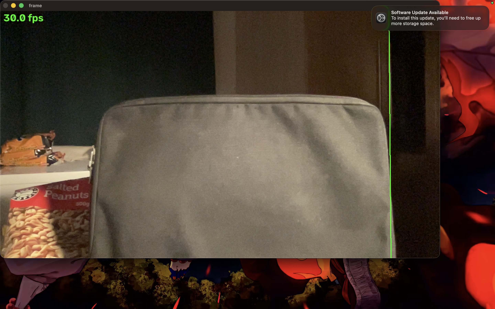

# Assignment 2: Results

Repository: https://github.com/A-Klang/ComputerVisionApplications_Results

## Time per frame

Final settings: s = 0.5, Canny 100/200, N = 1000, t = 2 px, k = 4.

| Capture (ms) | Canny (ms) | RANSAC (ms) | Live FPS |
|---|---|---|---|
| 4.5 | 0.4 | 11.5 | 29.7 |

Capture is mostly time spent waiting for the next camera frame, so it drops when the loop keeps up with 30 fps and rises to about 30 ms when it doesn't. Canny includes the grayscale conversion and resize.

## Edge points, inlier ratio and number of iterations

Typical frame at the final settings: 5386 edge points, 452 inliers, so an inlier ratio of 8.4 % and e = 0.916.

N = log(1 − p) / log(1 − (1 − e)²) with p = 0.95:

| Run | Edge points | Inliers | e | N from formula | N used |
|---|---|---|---|---|---|
| First run, dim light, 50/150 | 6056 | 326 | 0.946 | 1032 | 200 |
| Final settings | 5386 | 452 | 0.916 | 424 | 1000 |
| Canny 100/200, k = 1 | 4439 | 513 | 0.884 | 223 | 1000 |

I started at N = 200, but with the outlier ratio of the first run the formula asked for about 1000, so I raised it to 1000. In better light the formula only asks for 220 to 490, so 1000 has margin, but it covers the worst case I measured.

## Speed-ups

Live FPS is capped by the camera at 30 and drops to 15 as soon as a frame takes longer than 33 ms, so I also list processing FPS = 1 / (Canny + RANSAC).

**Image size** (dim light, Canny 50/150, all points)

| s | Processed width | Edge points | Canny (ms) | RANSAC (ms) | Processing FPS | Live FPS | Max angle RANSAC vs LS |
|---|---|---|---|---|---|---|---|
| 1.0 | 1280 | 5008 | 0.6 | 17.9 | 54 | 15 | 0.15° |
| 0.5 | 640 | 3667 | 0.4 | 15.5 | 63 | 23.5 | 0.35° |
| 0.25 | 320 | 1661 | 0.3 | 11.9 | 82 | 30 | 0.7° |

Fewer edge points means less work per iteration, so RANSAC gets faster. The points don't drop by 4 per halving since downscaling also sharpens the gradients per pixel. Line quality goes down with size: t = 2 px at s = 0.25 corresponds to 8 px in the full frame, and the RANSAC and refined lines differ by up to 0.7°.

**Canny thresholds** (s = 0.5, brighter light than the size runs, all points)

| Canny | Edge points | Inliers | Outliers per inlier | N from formula | RANSAC (ms) | Processing FPS | Live FPS |
|---|---|---|---|---|---|---|---|
| 50/150 | 6069 | 542 | 10.2 | 374 | 19.7 | 50 | 15 |
| 100/200 | 4439 | 513 | 7.7 | 223 | 16.8 | 58 | 15 |
| 150/300 | 2536 | 260 | 8.8 | 284 | 13.4 | 73 | 30 |

100/200 removes mostly texture while keeping the sleeve edge, so it gives the lowest outlier ratio. 150/300 is faster but starts cutting the sleeve edge itself: the inliers halve and the ratio gets worse again. I kept 100/200.

**Every k-th point** (s = 0.5, Canny 100/200, same scene)

| k | Edge points | RANSAC (ms) | Processing FPS | Live FPS | Inliers min to max |
|---|---|---|---|---|---|
| 1 | 5522 | 19.1 | 51 | 15 | 330 to 521 |
| 4 | 5386 | 11.5 | 84 | 30 | 194 to 594 |
| 10 | 5664 | 9.9 | 97 | 30 | 315 to 585 |

Inliers are counted on all points for the final line. k = 4 is what gets the loop to 30 fps. Going to k = 10 gains little since most of the remaining RANSAC time is per-iteration overhead, not the support test. On a single clear edge the line looked the same for all k, the inlier spread comes from camera noise. Where k matters is when two edges have similar support, see the failure case.

## Paper edge and other lines

A laptop sleeve stood in for the sheet of paper, with me and the room as background.

- Slow movement: tracks the edge well when it's close to the camera. Further away the edge gets too short in the image and the line never locks on. Now and then it jumps to my shoulder.
- Rotation: follows smoothly in the image plane until my arm comes into view near 90°, then it moves to the arm. Tilting the sleeve out of the plane works up to a point, then it jitters between the arm and random edges.
- Fast movement: keeps up mostly but lags for quick up and down movement. The edge disappears from the Canny output during fast motion because of motion blur.
- Partly out of view: holds until about half the edge has left the frame, then switches to the short side of the sleeve. It flickers just before the switch and locks on again immediately when brought back.

The detector always picks the edge with the most inliers, which is the longest edge with enough contrast to survive Canny. Every frame is solved independently, so it switches as soon as another edge has more support and flickers when two have about the same.

In the room it finds any long, high-contrast straight edge: the dark curtain against the white wall (`results/15_room_curtain_edge.png`), the shelves against the wall and very consistently the mirror edge on the wardrobe door (`results/14_room_mirror_edge.png`). Lower-contrast edges like the wardrobe sides in dim light lose out.

## Failure case

The target is the top edge of the sleeve, but the line has locked onto the vertical door frame behind it.

Both edges are long and high contrast, so they have similar support. RANSAC keeps whichever line has the most inliers in that frame, and with k = 10 the support is counted on a tenth of the points, so small differences in the count decide it.

## Raw logs and screenshots

All in `Assignment2/results/`: timing logs (`01` to `09`, `11`, `12`), notes from the paper and room tests (`13`), failure case (`10`) and room screenshots (`14`, `15`).
